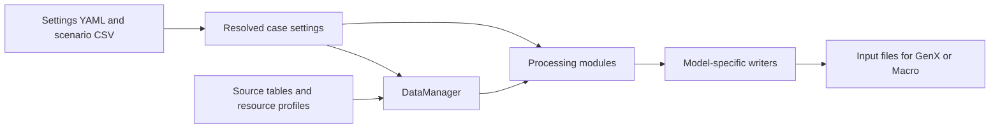

# Architecture Overview

PowerGenome is a **data pipeline**, not a power-system simulator. Settings select
and transform source data into inputs for an optimization model such as GenX.
The model is run separately.

## Core components

| Component | Responsibility |
| --- | --- |
| `run_powergenome.py` | CLI entry point; coordinates cases, periods, validation, processing, and writing. |
| `settings.py` | Loads YAML, resolves scenario/year overrides, and provides settings contexts. |
| `database.py` | DataManager: standardized table access over CSV, Parquet, SQLite, and DuckDB sources. |
| `generators.py`, `new_build.py` | Cluster existing units, construct new-build resources, and calculate resource attributes. |
| `resource_clusters.py` | Select renewable sites and aggregate their capacity, costs, and profiles. |
| `load_profiles.py`, `distributed_gen.py` | Build demand and distributed-generation contributions. |
| `fuels.py`, `transmission.py` | Construct fuel-price and inter-regional network inputs. |
| `GenX.py` | Format GenX inputs: resource tags, column naming, and output files. |

These responsibilities explain where to investigate a problem; normal studies
are configured through YAML rather than by calling these modules directly.

## Settings and scenario isolation

Settings load into a mutable dictionary-like `Settings` object. Each case/period
gets its own resolved settings, keeping scenario changes separate from the base
configuration. A settings context lets decorated functions obtain arguments
without every caller passing the entire dictionary.

This convenience does not make arbitrary settings names valid. Parameters still
need to match their consuming functions, and source tables need the expected
schemas. See [Configure Settings](../how-to/configure-settings.md) for loading
rules and [Scenario Management](scenarios.md) for override precedence.

## Centralized data access

DataManager is a singleton backed by an in-memory DuckDB connection. It maps
settings such as `generation_table` to standard names such as `generation`.
Processing modules request those standard names instead of knowing source
filenames.

By default, file-backed sources use lazy views rather than loading all data at
initialization. Row filters and optional column projection control the exposed
data. Source columns retain their names; the access layer is not a general
schema-conversion service.

At case/period boundaries, the pipeline updates table configurations for the
resolved settings. Thus one command can use different demand scenarios without
rewriting downstream processing. See [Data Tables Settings](../reference/settings/data-tables.md)
for source lookup and filter semantics.

## From resources to model-specific files

Existing generators are grouped by region and technology, then clustered using
the configured features. New-build resources come from technology cost and
performance tables; renewable site data adds supply limits and generation
profiles. Demand, fuels, transmission, and policies are built alongside them.

The resulting DataFrames are formatted for the selected model. For default
GenX output, resource attributes are split across resource-type files; they are
not written as one legacy `Generators_data.csv`. Optional Macro output uses the
same processed data but has its own asset and file conventions. See
[Output Formats](output-format.md).

## Scale and fidelity trade-offs

Runtime and memory use grow with renewable site counts, profile length,
existing-unit counts, and requested clusters. Filters, renewable cluster caches,
and regional aggregation can reduce work, but they can also change the study's
representation.

Time-domain reduction reduces downstream optimization size; it is not a reason
to choose a universal number of hours. Select and validate spatial, technology,
and temporal resolution against the questions your study must answer.

Some conventions reflect US sources such as EIA and NREL ATB. Other geographies
can use custom data, but must supply compatible schemas and mappings rather than
only changing region labels.

## Related documentation

- [Data Pipeline Flow](pipeline.md): processing order and intermediate products.
- [Generator Clustering](clustering.md): aggregation methods and trade-offs.
- [Input Table Schemas](../reference/schemas/input-tables.md): source requirements.
- [Contributing](../about/contributing.md): development and testing workflow.
